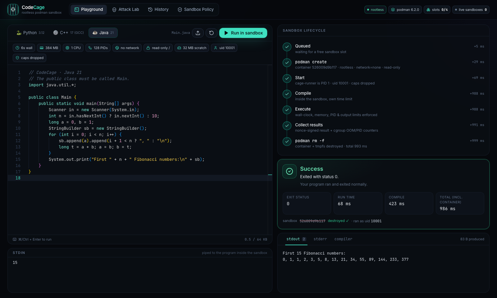
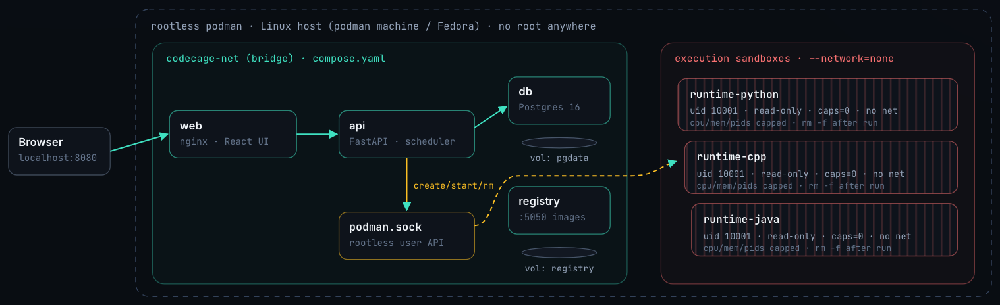
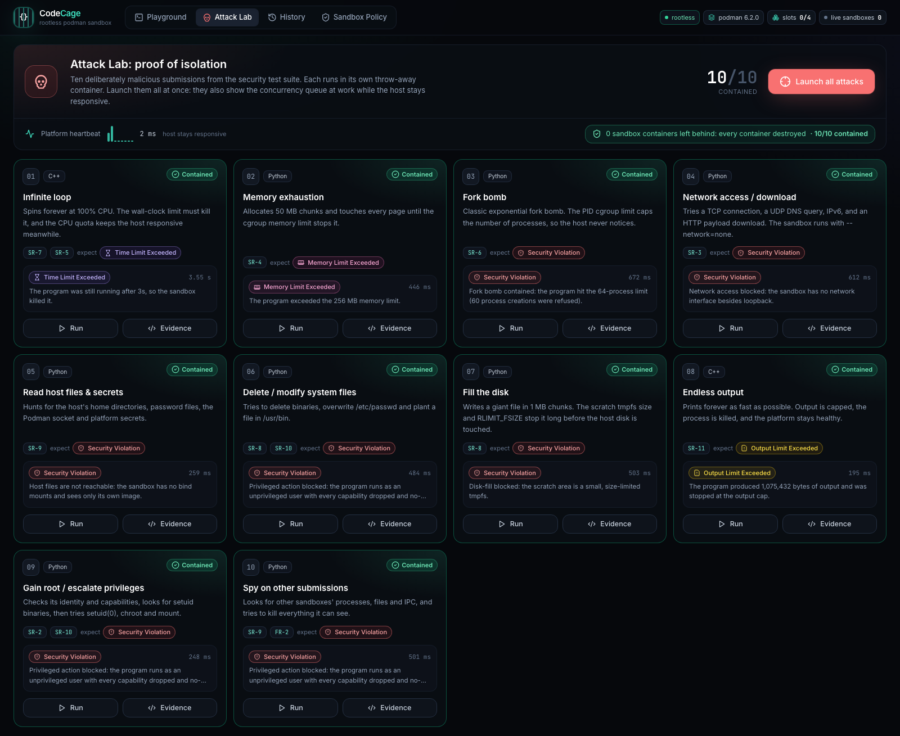

# CodeCage

**A secure sandboxed code execution platform using rootless Podman containers.**
Course project for *21CSE216P: Linux and Container Technologies*.

Users submit Python, C++ or Java code (plus optional stdin). Each submission runs in a fresh, short-lived **rootless** Podman container with no network, a read-only filesystem, no capabilities and strict CPU, memory, PID, time and output limits. The user gets back the output and a verdict, and the container is destroyed afterwards.



## Quick start

```bash
./codecage up        # checks the host, builds images if needed, starts everything
open http://localhost:8080
```

| Command | What it does |
|---|---|
| `./codecage up` | One-command start: host checks → image build/push (first run) → `podman compose up` |
| `./codecage suite` | Runs the 10-attack security suite and writes evidence to [`reports/`](reports/security-results.md) |
| `./codecage status` | Platform containers, **leftover sandboxes (should be 0)**, network, volumes |
| `./codecage restart` | `down` + `up`; submission history persists |
| `./codecage images` | Runtime image sizes and the local registry catalogue |
| `./codecage doctor` | Verifies rootless mode, cgroup v2 controllers, socket and compose |

Setting up a fresh machine (macOS or Fedora/RHEL) is covered in **[docs/SETUP.md](docs/SETUP.md)**. The viva walkthrough is in **[docs/DEMO.md](docs/DEMO.md)**.

## How it works



- **Platform** (`compose.yaml`): `web` (nginx + React), `api` (FastAPI), `db` (Postgres on the `codecage-pgdata` volume) and `registry` (local image registry). All four share the `codecage-net` bridge network.
- **Sandboxes** are created by the API through the user's **rootless Podman socket**, one per submission, with `--network=none`. They never join `codecage-net`.
- Inside each sandbox, **`cage-runner`** (a static Go binary) runs as PID 1. It compiles and runs the code, enforces the wall-clock and output limits, reads the cgroup OOM and PID counters, and reports a nonce-signed result.

Full design notes, including a table mapping each security measure to the threat it blocks, are in **[docs/ARCHITECTURE.md](docs/ARCHITECTURE.md)**.

### Verdicts

`Success` · `Compilation Error` · `Runtime Error` · `Time Limit Exceeded` · `Memory Limit Exceeded` · `Output Limit Exceeded` · `Security Violation`. Each verdict comes with a plain-English explanation aimed at beginners.

### Security test suite: 10/10 contained



| # | Attack | Result |
|---|---|---|
| 1 | Infinite loop | Time Limit Exceeded (killed at 3 s) |
| 2 | Memory bomb | Memory Limit Exceeded (cgroup OOM kill) |
| 3 | Fork bomb | Security Violation (pids.max reached, about 60 forks refused) |
| 4 | Network / download | Security Violation (ENETUNREACH; only `lo` exists) |
| 5 | Read host files / secrets | Security Violation (nothing mounted) |
| 6 | Delete / modify system files | Security Violation (read-only rootfs, EACCES) |
| 7 | Fill the disk | Security Violation (tmpfs size limit and RLIMIT_FSIZE) |
| 8 | Endless output | Output Limit Exceeded (killed after 1 MB) |
| 9 | Privilege escalation | Security Violation (setuid/mount → EPERM, CapEff=0) |
| 10 | Spy on other submissions | Security Violation (private PID ns; PID 1 survives a SIGKILL sweep) |

Full evidence (stdout/stderr, exit codes, cgroup counters, container IDs) is in [`reports/security-results.md`](reports/security-results.md).

## Repository layout

```
codecage                  control script (up/down/restart/suite/status/…)
compose.yaml              multi-container platform definition
config/languages.yaml     language registry: add a language = new image + one entry
runtimes/runner/          cage-runner: in-sandbox supervisor (Go, static)
runtimes/{python,cpp,java}/Containerfile   hardened runtime images
api/                      FastAPI backend (sandbox driver, scheduler, verdicts, history)
web/                      React + Monaco UI, served by unprivileged nginx
attacks/                  the 10 malicious submissions (security test suite)
tests/security/run_suite.py   automated suite runner → reports/
docs/                     setup guide, demo script, architecture notes
```

## Adding a language

1. Create `runtimes/<lang>/Containerfile` (copy an existing one; keep the runner stage and the hardening step).
2. Add an entry to `config/languages.yaml` (image, file name, compile/run argv, limits, template).
3. Add `<lang>` to `RUNTIMES` in `./codecage`, then run `./codecage rebuild`.

You don't need to change the API or the UI: both read the language registry.
