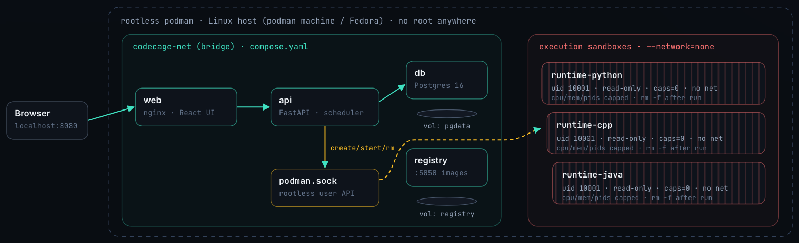

# CodeCage architecture and security design

This document backs the project report. It covers the architecture, the sandbox lifecycle, each security measure and the threat it blocks, image design decisions, limitations and future scope.



## 1. Components

| Component | Image | Role | Network |
|---|---|---|---|
| `web` | `localhost/codecage/web:1.0` (nginx-unprivileged, uid 101) | Serves the React UI; reverse-proxies `/api` with SSE unbuffered | `codecage-net`, publishes 8080 |
| `api` | `localhost/codecage/api:1.0` (python:3.12-slim) | Validation, FIFO scheduler, sandbox driver, verdicts, history, logs | `codecage-net` |
| `db` | `postgres:16-alpine` | Submission history on volume `codecage-pgdata` | `codecage-net` only |
| `registry` | `registry:2` | Stores the runtime images (`localhost:5050/codecage/runtime-*`) on volume `codecage-registry` | `codecage-net`, publishes 5050 |
| sandboxes | `runtime-{python,cpp,java}:1.0` | One per submission, destroyed after the run | **`none`** |

The API reaches Podman through the **user's rootless REST socket** (`/run/user/<uid>/podman/podman.sock`), bind-mounted at `/run/podman/podman.sock`. The API container uses `label=disable` so SELinux allows the socket connection. This exception applies to the API container only; sandboxes keep their SELinux labels.

## 2. Sandbox lifecycle (per submission)

```
POST /api/submissions ─► validate (lang, empty, 64 KB code, 32 KB stdin)
        │
        ▼
 FIFO queue (≤16) ─► semaphore (≤4 running) ─► 429 if full
        │
        ▼
 podman create  ── labels codecage.sandbox=1, codecage.submission=<id>
        │            env CAGE_SPEC / CAGE_SRC / CAGE_STDIN (base64)
        ▼
 podman start   ── cage-runner = PID 1, uid 10001
        │             ├─ write source → /sandbox (tmpfs)
        │             ├─ PHASE compile  (own timeout)  ─► Compilation Error?
        │             ├─ PHASE run      (wall limit, output cap, stdin pipe)
        │             └─ RESULT <nonce> {exit, signal, timed_out, stdout, stderr,
        │                                oom_kills (memory.events), pids_max_hits (pids.events)}
        ▼
 API follows the logs live → SSE events to the browser
 outer watchdog: kill container at compile+run+15 s
        ▼
 inspect (OOMKilled) → classify verdict → store in Postgres → log JSON line
        ▼
 podman rm -f   ── in `finally`: always, even on error or timeout
 janitor: at API start + every 30 s, remove labelled containers not in an active run
```

## 3. Security measures

| Req | Measure | Threat blocked | Evidence |
|---|---|---|---|
| SR-1 | Rootless Podman. `./codecage doctor` and the API refuse or flag rootful mode | Container escape gaining host root | Health: `rootless=true` |
| SR-2 | `--user 10001:10001`; images have no sudo/su and every setuid bit is stripped | Privileged actions inside the container | Attack 9: `uid=10001`, no setuid binaries |
| SR-3 | `--network=none` (loopback only); never attached to `codecage-net` | Exfiltration, downloads, attacking the DB/API | Attack 4: `interfaces ['lo']`, ENETUNREACH |
| SR-4 | `--memory` = `--memory-swap` (no swap) | Host memory exhaustion | Attack 2: `oom_kill` counter = 1 |
| SR-5 | `--cpus 1.0` (cgroup `cpu.max`) | CPU starvation | Attack 1: load average stays flat |
| SR-6 | `--pids-limit 64` (128 for Java) | Fork bombs | Attack 3: ≈60 forks refused (`pids.events`) |
| SR-7 | Runner kills the process group at the wall limit; the API watchdog kills the container | Infinite loops, sleeps | Attack 1: SIGKILL at 3.00 s |
| SR-8 | `--read-only` rootfs; `/sandbox` tmpfs 32 MB (exec), `/tmp` 16 MB (noexec); `RLIMIT_FSIZE` 16 MB | Tampering, filling the disk | Attacks 6 and 7: EROFS, EFBIG |
| SR-9 | No bind mounts or volumes; code via env; Podman's default `/run/secrets` subscription mount shadowed by an empty read-only tmpfs; private PID, IPC, mount and UTS namespaces | Reading host files, secrets, other runs | Attacks 5 and 10 |
| SR-10 | `--cap-drop ALL`, `no-new-privileges`, default seccomp, `RLIMIT_NOFILE` 64, `RLIMIT_CORE` 0 | Privilege escalation, kernel attack surface | Attack 9: `CapEff=0`, `NoNewPrivs=1`, `Seccomp=2`, mount/chroot/setuid → EPERM |
| SR-11 | 64 KB kept per stream; process group killed at 1 MB total | Log, memory and disk exhaustion | Attack 8: killed at about 1 MB |

### Supervisor hardening (cage-runner)
- **PID 1 in the sandbox's PID namespace.** The kernel ignores signals sent to a namespace's init from inside the namespace unless init has a handler. The runner also ignores the catchable termination signals, so the program cannot kill its supervisor. Attack 10 sweeps SIGKILL over every PID and the runner survives.
- **Non-dumpable** (`prctl(PR_SET_DUMPABLE, 0)`). The program, running as the same uid, cannot read `/proc/1/environ`, `/proc/1/fd` or `/proc/1/root` (attack 10 tries this last one).
- **Nonce-signed results.** The API only trusts output lines that start with a random 128-bit per-run nonce. Program output goes through pipes, never to the container log.
- **Clean environment.** Programs get a fixed minimal environment (`PATH`, `HOME=/sandbox`, `LANG`). The runner clears its own environment after reading it.

## 4. Image design decisions

| Image | Base | Size | Contents | Notes |
|---|---|---|---|---|
| runtime-python | `python:3.12-alpine` | **≈55 MB** | CPython + stdlib | pip, ensurepip, tests, tkinter, idle and lib2to3 removed |
| runtime-cpp | `alpine:3.20` + `g++ musl-dev` | **≈175 MB** | GCC toolchain only | man pages, docs and LTO plugin removed |
| runtime-java | `alpine:3.20` + jlink'd JDK 21 | **≈68 MB** | `java.base, java.logging, java.xml, jdk.compiler, jdk.zipfs` | Versus ≈350 MB for the full Temurin JDK |

All three images share these properties:
- **Multi-stage build.** `golang:1.23-alpine` compiles the static `cage-runner` (`CGO_ENABLED=0`, stripped). Only the binary is copied into the final image.
- **Final hardening step.** Delete `apk` and its database, remove every setuid/setgid bit, then delete **busybox** and all its symlinks. That removes `/bin/sh` and every coreutil, so there is no shell to drop into (`podman run --entrypoint /bin/sh …` fails with *executable not found*).
- `USER 10001`, `WORKDIR /sandbox`, `ENTRYPOINT ["/usr/local/bin/cage-runner"]`.
- Alpine/musl was chosen for its size. The trade-off is that musl's DNS and error strings differ slightly from glibc's, and the verdict patterns account for both.

## 5. Verdict classification

Checks run in this order (`api/app/verdict.py`):
1. Runner could not start the toolchain → **Internal Error**
2. Compile non-zero or timed out → **Compilation Error**
3. `pids.events max > 0` → **Security Violation** (fork bomb contained)
4. `memory.events oom_kill > 0`, Podman `OOMKilled`, or `MemoryError` / `OutOfMemoryError` / `bad_alloc` → **Memory Limit Exceeded**
5. Output kill threshold hit → **Output Limit Exceeded**
6. Timed out → **Time Limit Exceeded**
7. Non-zero exit with stderr showing a blocked action (network, EROFS, ENOSPC/EFBIG, EAGAIN, EPERM/EACCES, missing host paths) → **Security Violation** with the specific reason and SR
8. Other non-zero exit or signal → **Runtime Error** (signals explained, e.g. SIGSEGV, SIGFPE)
9. Otherwise → **Success**

## 6. Concurrency, persistence, logging
- **FR-7:** an `asyncio.Semaphore(4)` limits running sandboxes, and a FIFO queue holds up to 16 more. The queue slot is reserved before any `await`, so bursts cannot overshoot it. A test with 30 simultaneous submissions gave 4 running, 16 queued and 10 rejected with HTTP 429, and every accepted job returned only its own output.
- **FR-6:** Postgres on the named volume `codecage-pgdata` survives `./codecage restart`, `down` and `up`. Runs that were in flight during a crash are marked *lost* on the next start.
- **Logging:** one JSON line per execution (`submission, language, verdict, reason, wall_ms, run_ms, container`), visible with `./codecage logs`.

## 7. Limitations
- **The API holds the user's Podman socket.** Anyone who compromises the API can start arbitrary rootless containers as that user (but cannot get host root). A production design would put a narrowly scoped executor service in front of the socket.
- All sandboxes share the same host subuid range. Isolation between them comes from namespaces and cgroups, not separate uids. `--userns=auto` would give each sandbox its own range.
- The default seccomp profile is used; there is no custom syscall allow-list per language.
- Wall-clock time includes container start-up (about 0.2–0.4 s), and only the program's own run time is enforced against the limit.
- Security-violation reasons are inferred from error messages and cgroup counters. A program that catches its own errors and exits 0 gets *Success*, even though the action was still blocked.
- Built and tested on Podman 6.2 (macOS `podman machine`, Fedora 44 VM). On native Linux, cgroup controller delegation must be enabled (see SETUP).

## 8. Future scope
- Test-case grading (compare stdout with expected output, per-test verdicts)
- More languages (each is one Containerfile plus one YAML entry)
- A custom seccomp profile and/or gVisor (`runsc`) or Kata as the OCI runtime
- `--userns=auto` per sandbox, plus a dedicated executor service holding the socket
- Running sandboxes as Kubernetes/OpenShift Jobs with `restricted-v2` SCC, NetworkPolicy deny-all, and ResourceQuota
- User accounts and assignments for classroom use
